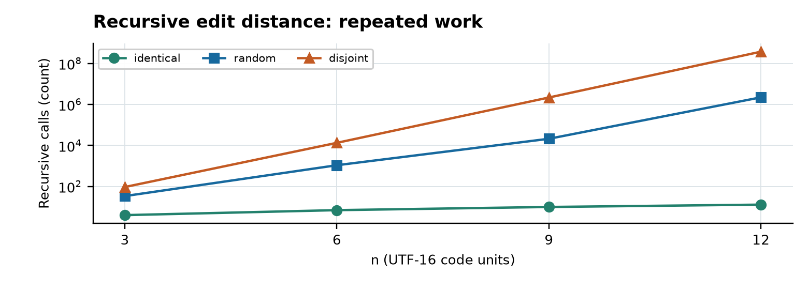
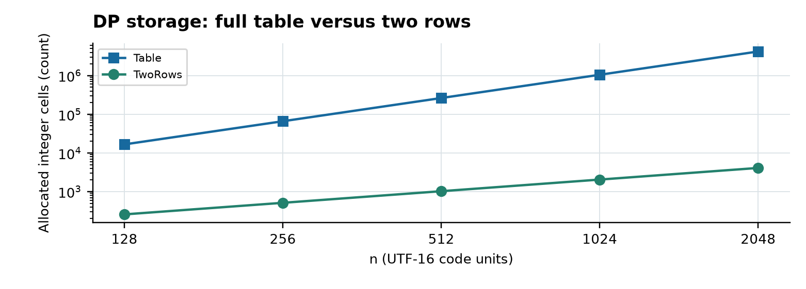
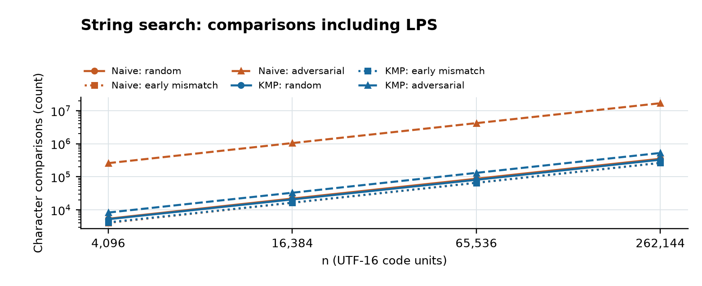
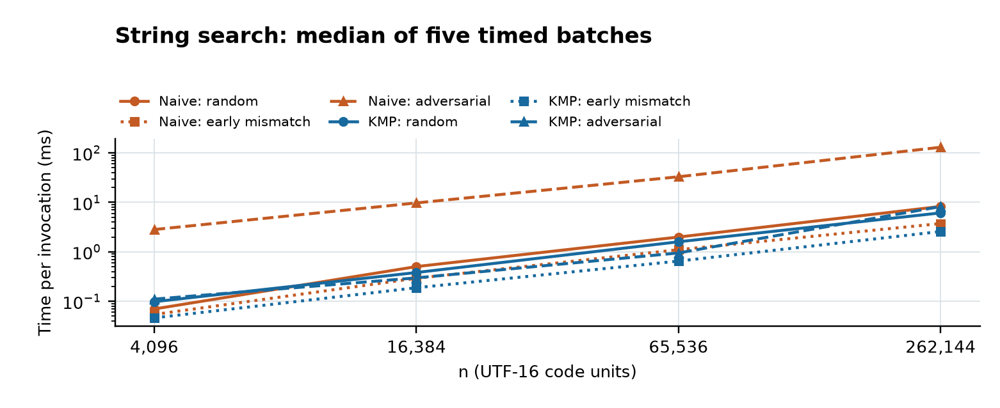

# Assignment 4 - Dynamic Programming and String Algorithms

**Dyussenbay Damir | SE-2523 | 7 November 2026**

## Experiment Design Card (before the first run)

| Field | Plan |
|---|---|
| Questions | Edit distance: how do structure and size affect recursive work, DP time and storage? Search: how much does a long nearly matching prefix hurt Naive relative to KMP? |
| Sizes and why | Recursive n = 3, 6, 9, 12 (4x span, bounded exponential work). Table/TwoRows n = 128, 256, 512, 1024, 2048 (16x). Naive/KMP text n = 4096, 16384, 65536, 262144 (64x); pattern m = 64. The larger sizes expose scaling without an unbounded run. |
| Purposeful inputs | Edit: identical random strings expose the equal-character shortcut; independent ABCD strings give a baseline; A^n versus B^n forces all recursive branches. Search: random ABCD is the baseline; A^n versus B^64 fails immediately; A^n versus A^63 B forces late mismatches at every Naive alignment. |
| Metrics | Measured inside the code: recursive calls, interior DP cells, character comparisons, and allocated integer cells. Search comparisons include both the scan and KMP LPS construction. Also record elapsed time and report the median of five runs. Counters explain work independently of the clock. |
| Protocol | Custom fixed-seed generator, seed 20261107; same input across algorithms of the same size. Inputs are generated before timing. Two warm-up batches, then five recorded batches; time_ms = batch_time_ms / iterations. Recursion batches: 10000, 100, 2, 1; DP: 64, 16, 4, 1, 1; search: 256, 64, 16, 4. Counters are per invocation and checked between batches. |
| Prediction | Disjoint recursion grows exponentially; identical recursion is linear. Both DPs evaluate n^2 states, with quadratic versus linear integer storage. Naive is costly on late mismatches; KMP remains O(n+m). With fixed m, both searches grow linearly in n but have different constants. Naive can win on immediate mismatches. |
| Planned plots | Recursive calls (log y): repeated work. DP cells allocated (log-log): storage growth. Search comparisons (log-log): sensitivity to input. Median search milliseconds (log-log): agreement and differences between clock and counters. |
| Reproducibility | Inputs, results and counters repeat exactly; elapsed time cannot. The design was committed before the first benchmark. No experiment sizes, input types or predictions were changed after measurements. This is an instrumented experiment, not a JMH benchmark. |

The original card and Git history are retained in EXPERIMENT_DESIGN.md.

## Edit distance: results

Disjoint strings require 377,393,953 calls at n=12, compared with 13 for identical strings; the logarithmic axis exposes the growth gap.

At n=2048, TwoRows uses 4,098 integer cells versus 4,198,401 for Table, a 1024.5x reduction; both still evaluate 4,194,304 interior states.

| Input (n=m=2048) | Table median (ms) | TwoRows median (ms) |
|---|---:|---:|
| identical | 106.303900 | 121.096100 |
| random | 232.350400 | 113.635000 |
| disjoint | 116.179100 | 100.449700 |

Prediction versus result. Disjoint recursion increased from 94 calls at n=3 to 377,393,953 at n=12, whereas identical inputs used n+1 calls. Both DP variants measured n^2 interior states for every input type; the predicted quadratic/linear storage difference also held. For random n=2048, Table took 232.350400 ms and TwoRows 113.635000 ms. Timings need not grow smoothly because compilation, allocation and cache effects differ even when operation counts match. The counters support the complexity claim more directly than a timing ranking.

## String search: results

At n=262144 and m=64, adversarial Naive makes 31.99x as many comparisons as KMP including LPS, while both curves are linear in n for this fixed m.

On the largest adversarial input, the measured medians are 130.569475 ms for Naive and 8.249400 ms for KMP (15.83x); random and early-mismatch inputs show why input type matters.

Prediction versus result. At the largest adversarial size, Naive counted 16,773,184 scan comparisons; KMP counted 524,225 scan plus 125 LPS comparisons. These match (n-m+1)*m for Naive and near-2n scan work for KMP on this constructed input. The long prefix caused the predicted penalty. Because m=64 is fixed, these measurements establish different constants along linear curves; they do not empirically establish quadratic growth in n. A separate experiment varying m with n would be needed for that claim. One surprise: Naive made slightly fewer comparisons on early mismatches, yet KMP had a lower median at all four sizes; comparison counts omit loop bookkeeping and JIT effects, so fewer comparisons need not mean lower elapsed time.

## Short answers

### 1. Which input made search slowest, and why?

The slowest measured search configuration was Naive on adversarial input at n=262144, with median 130.569475 ms. The constructed A^n text and A^63 B pattern force Naive to compare 64 characters at every feasible starting position before failing. KMP reuses the border information after each mismatch and does not restart that long prefix. This worst-case input explains the work counts, although timing order among cheaper cases can still depend on the machine.

### 2. How large an n could recursive edit distance handle?

The largest tested length was n=12, which completed on all three input types; the disjoint case needed 377,393,953 calls and median 4115.257800 ms. The stopping point was the preselected experiment limit, not an observed crash or timeout. Repeated branching makes larger disjoint inputs increasingly expensive, whereas identical strings take only n+1 calls. Therefore n=12 is a demonstrated feasible size, not a hardware maximum; sufficiently long equal strings would eventually be limited by recursive stack depth.

### 3. What is gained and lost with two rows?

TwoRows preserves the exact distance and O(n*m) running time while reducing integer storage from O(n*m) to O(m). At n=m=2048 the allocation counters were 4,198,401 and 4,098 cells, a 1024.5x reduction. The discarded rows are unavailable for ordinary backtracking, so this version returns the distance without the full edit script. Reconstructing a script needs extra computation or a different divide-and-conquer method; two rows also do not guarantee a fixed timing advantage.

### 4. Which search would you choose for the city platform?

I would choose KMP for exact pattern search through long city log files because O(n+m) work limits the damage caused by repetitive text and long partial matches. The LPS setup needs O(m) extra memory and can cost more than Naive on simple inputs. For the stated mix of potentially long logs, predictable worst-case behavior is more valuable than avoiding that small setup cost. Typo correction in street names is a separate task: KMP is exact matching, so edit distance is still needed for approximate suggestions.

## A paragraph on time

The measurements contain 330 positive time samples across 66 configurations, with two warm-up batches and five recorded batches each. Times are shown as median milliseconds per invocation, not rounded to whole milliseconds. Small recursive cases include substantial loop/timer overhead; Java JIT compilation, garbage collection, allocation and CPU activity can also disturb scaling. The timed algorithms include their counters and, for KMP, preprocessing; generation and CSV writes are excluded. Consequently the figures describe this instrumented program on this machine, and operation/allocation counters are essential evidence alongside elapsed time.

**Environment:** Windows 11 amd64; OpenJDK 64-Bit Server VM 27; max JVM heap 512 MiB; 4 available processors; seed 20261107.

**Validation:** 308 JUnit 5 tests passed, with zero failures, errors or skips: required reference/edge cases, 100 random edit pairs, 100 random search cases and 100 LPS oracle cases, plus counter/reset checks.

**Measurement scope:** aux_cells counts algorithm-owned integer cells, not JVM bytes, array headers, output lists or stack memory. Strings and indices use UTF-16 code units.

**AI use and source:** OpenAI Codex assisted with implementation, tests, measured experiments and writing. Requirements and reference values came from the supplied Assignment 4 PDF. Full acknowledgement and reproduction commands are in README.md.
